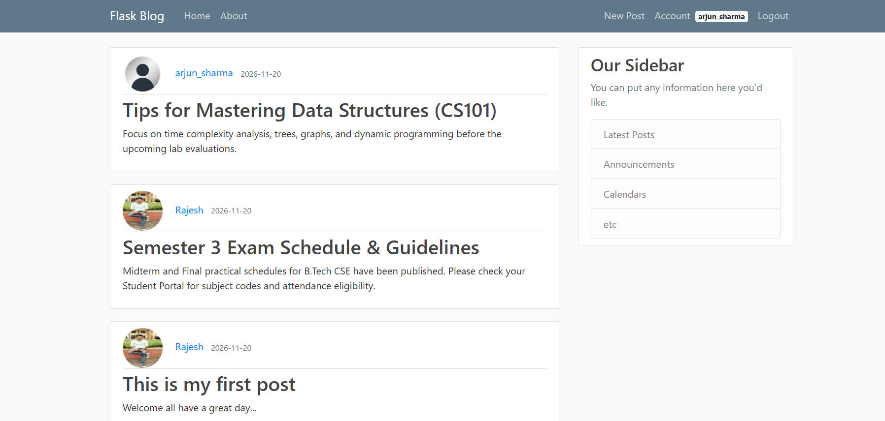
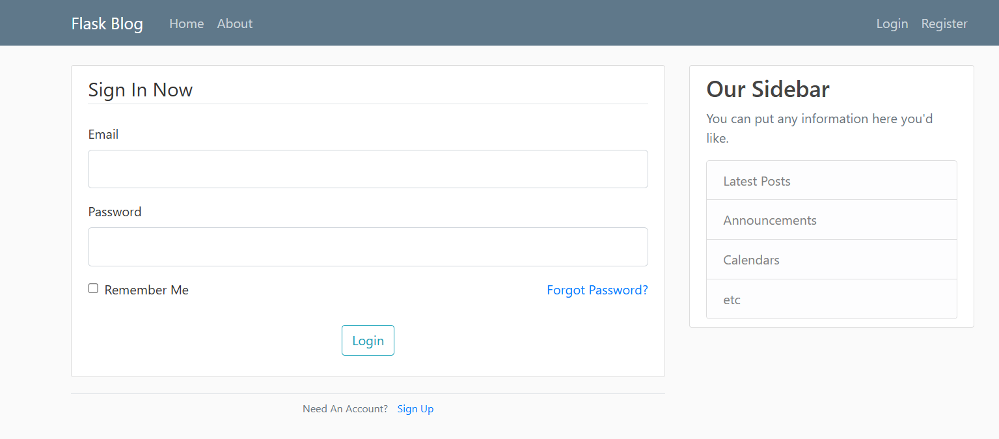
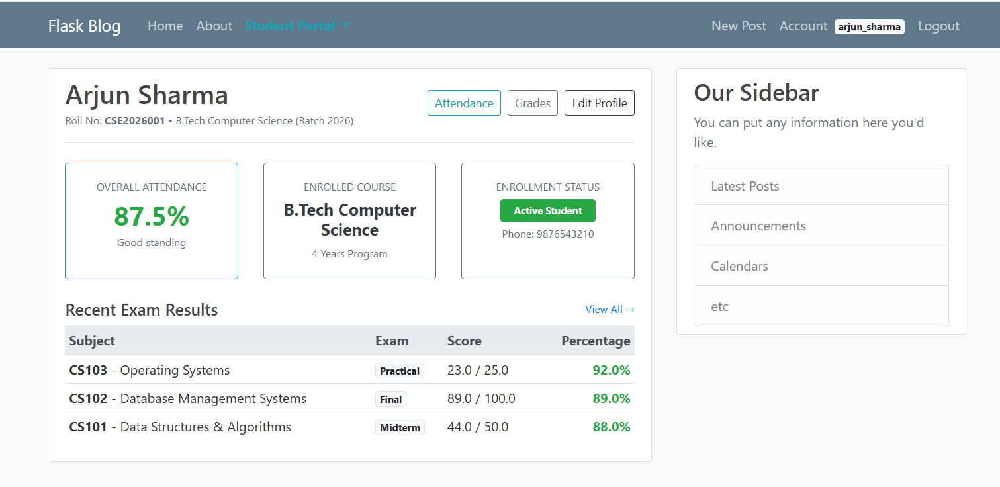
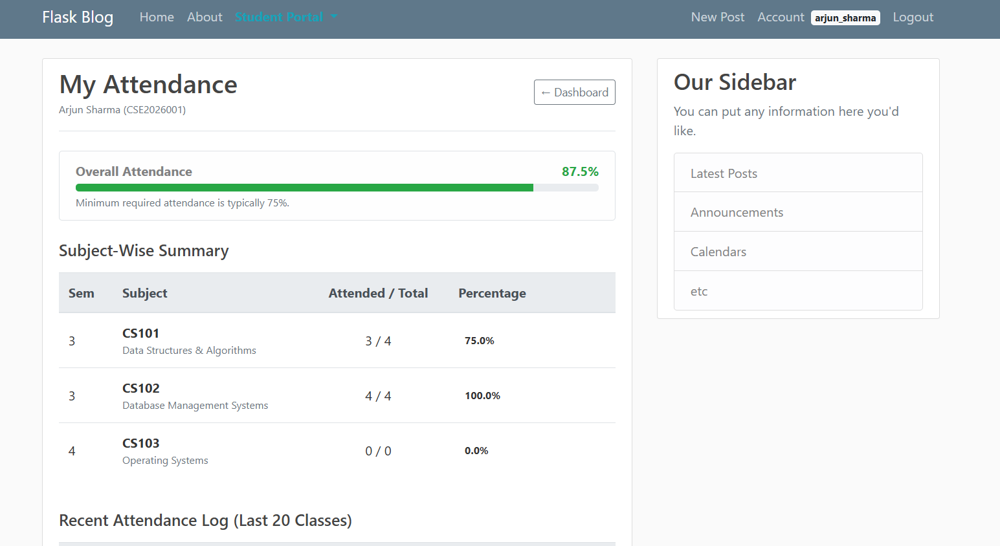
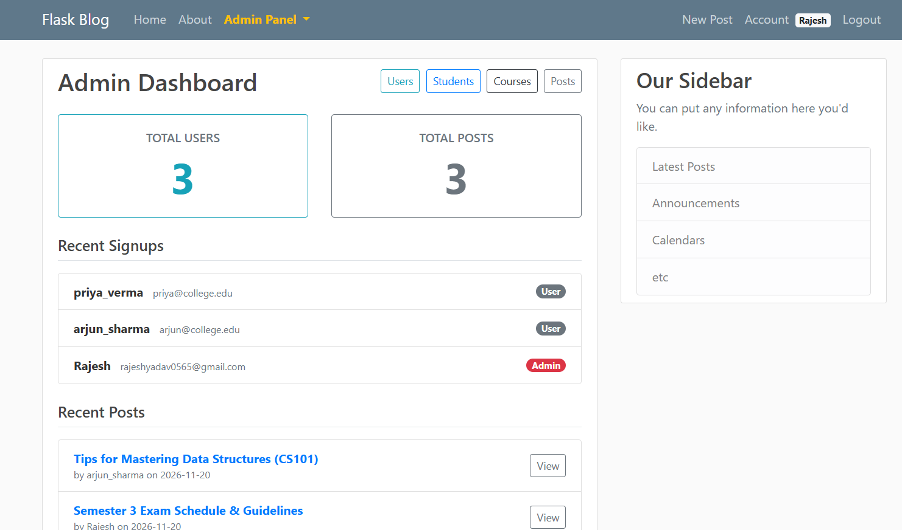
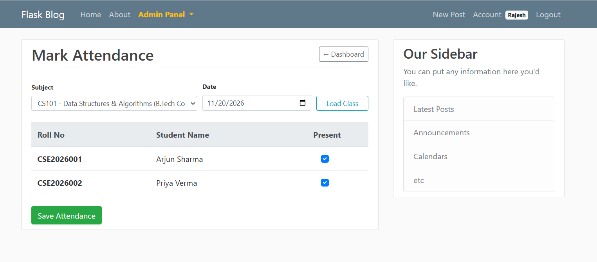

# Academic & Community Blog Portal (Flask + PostgreSQL)

A full-stack, role-based web application built with **Python (Flask 3.1)**, **SQLAlchemy 2.1**, **Bootstrap 4**, and **PostgreSQL / SQLite**. It combines a multi-user community blog with a complete **Student Portal** (attendance tracking, exam grades, academic profile) and an **Admin / Moderator Control Panel** (course & subject management, student enrollment, bulk attendance, grade entry, and content moderation).

---

## Table of Contents
1. [Key Features & Role Permissions](#1-key-features--role-permissions)
2. [Project Structure](#2-project-structure)
3. [Screenshots & Visual Guide](#3-screenshots--visual-guide)
4. [Quick Start: Running with Docker (Recommended)](#4-quick-start-running-with-docker-recommended)
5. [Local Development Setup (Without Docker)](#5-local-development-setup-without-docker)
6. [Step-by-Step User & Student Guide](#6-step-by-step-user--student-guide)
7. [Step-by-Step Admin & Moderator Guide](#7-step-by-step-admin--moderator-guide)
8. [Running Automated Tests (`pytest`)](#8-running-automated-tests-pytest)
9. [Pushing to GitHub & Deploying Live](#9-pushing-to-github--deploying-live)

---

## 1. Key Features & Role Permissions

The application enforces strict role-based access control (`UserRole` enum) across every route and navbar menu:

| Role | Capabilities |
| :--- | :--- |
| **Guest (Logged Out)** | Read paginated blog posts, filter posts by author, register an account, or request a password reset email. |
| **User (`user`)** | Create, edit, and delete their own blog posts; update username, email, and auto-resized profile picture. |
| **Student (`student`)** | Everything a `User` can do, plus access the **Student Portal**: view overall & subject-wise attendance progress bars, inspect exam marks/percentages, and update personal contact info. |
| **Moderator (`moderator`)** | Moderate/delete any user post, bulk-mark daily class attendance by subject, and record/update student exam grades. |
| **Admin (`admin`)** | Full system access: view system stats, promote/demote user roles, delete users, create courses & subjects, enroll users as students, activate/deactivate students, and perform all moderator tasks. |

---

## 2. Project Structure

```text
blog/
├── blog/
│   ├── __init__.py          # Application factory (create_app) & blueprint registration
│   ├── config.py            # DevConfig, TestConfig, and ProdConfig classes
│   ├── extensions.py        # SQLAlchemy, Migrate, Bcrypt, LoginManager, Mail, CSRFProtect
│   ├── main/                # Public home feed & about routes
│   ├── users/               # Auth, profile picture processing, password reset, @role_required
│   ├── posts/               # Blog CRUD routes, forms & models
│   ├── students/            # Course, Subject, Student, Attendance, Grade models & student portal
│   ├── admin/               # Admin & Moderator management routes and forms
│   ├── errors/              # Custom 400, 403, 404, 405, 500 error handlers
│   ├── static/              # main.css & uploaded profile_pic/ directory
│   └── templates/           # 28 Bootstrap 4 Jinja2 templates organized by blueprint
├── migrations/              # Alembic database migration scripts
├── tests/                   # Automated pytest test suite (conftest.py + test_app.py)
├── docs/screenshots/        # UI screenshots for documentation
├── Dockerfile               # Python 3.12 + Gunicorn production image
├── docker-compose.yml       # Web + PostgreSQL 16 multi-container setup
├── requirements.txt         # Pinned Python dependencies
├── run.py                   # Local development entry point
└── wsgi.py                  # Production WSGI entry point for Gunicorn
```

---

## 3. Screenshots & Visual Guide

### Public Feed & Authentication

| Home Feed (`/`) | Login & Registration (`/login`, `/register`) |
| :---: | :---: |
|  |  |

### Student Portal (`/student/dashboard`)

| Student Dashboard | Subject-Wise Attendance & Exam Grades |
| :---: | :---: |
|  |  |

### Admin & Moderator Control Panel (`/admin/dashboard`)

| Admin Dashboard & User Roles | Courses, Enrollment & Bulk Attendance |
| :---: | :---: |
|  |  |

---

## 4. Quick Start: Running with Docker (Recommended)

### Prerequisites
* [Docker Desktop](https://docker.com) (with WSL 2 integration enabled on Windows)

### Step 1: Configure Environment Variables
Create a `.env` file in the project root:

```env
SECRET_KEY=replace-with-a-long-random-secret-key
FLASK_ENV=production
HTTPS_ENABLED=false

# Optional: Gmail SMTP credentials for password reset emails
MAIL_SERVER=://gmail.com
MAIL_PORT=587
MAIL_USE_TLS=true
MAIL_USERNAME=your-email@gmail.com
MAIL_PASSWORD=your-16-char-app-password
MAIL_DEFAULT_SENDER=your-email@gmail.com
```

### Step 2: Build & Start the Containers
```bash
docker compose up --build -d
```
This automatically starts **PostgreSQL 16**, applies all **Alembic migrations** (`flask db upgrade`), and boots **Gunicorn** on **`http://localhost:8000`**.

### Step 3: Create Your First Admin Account
1. Open **`http://localhost:8000/register`** in your browser and register an account.
2. Promote that account to `ADMIN` from your terminal (replace `your-email@gmail.com` with your registered email):
   ```bash
   docker compose exec web python -c "from blog import create_app; from blog.config import ProdConfig; from blog.extensions import db; from blog.users.models import User, UserRole; app = create_app(ProdConfig); app.app_context().push(); u = db.session.scalar(db.select(User).where(User.email == 'your-email@gmail.com')); u.role = UserRole.ADMIN; db.session.commit(); print('Promoted to ADMIN')"
   ```
3. Refresh the browser—the **Admin Panel** dropdown will now appear in the top navigation bar.

---

## 5. Local Development Setup (Without Docker)

1. **Create and activate a virtual environment:**
   ```bash
   python3 -m venv venv
   source venv/bin/activate
   ```
2. **Install dependencies:**
   ```bash
   pip install -r requirements.txt
   ```
3. **Apply database migrations (creates `instance/dev.db`):**
   ```bash
   flask db upgrade
   ```
4. **Run the development server:**
   ```bash
   python3 run.py
   ```
   Visit **`http://127.0.0.1:5000`**.

---

## 6. Step-by-Step User & Student Guide

### A. Registering, Logging In & Updating Your Account
1. **Register:** Click **Register** in the top-right navbar, enter a unique **Username**, **Email**, and **Password** (minimum 6 characters), and submit.
2. **Login:** Click **Login**, enter your email and password, and optionally check **Remember Me** to stay signed in.
3. **Forgot Password:** Click **Forgot Password?** on the login screen, enter your email address, and follow the timed reset link sent to your inbox.
4. **Account Settings (`/account`):** Click **Account** in the navbar to update your username, email, or upload a profile picture (`.jpg` or `.png`—automatically cropped and resized to `125x125 px`).

### B. Publishing & Managing Blog Posts
1. **Create a Post:** Click **New Post** in the navbar, enter a **Title** (3–100 characters) and **Content**, and click **Post**.
2. **View & Filter Posts:** Click any post title on the Home feed to open its full page, or click an author's username to see all posts written by that user.
3. **Edit or Delete Your Post:** Open your post and click **Update Post** to edit it, or **Delete Post** to confirm deletion via the modal dialog.

### C. Using the Student Portal (Enrolled Students Only)
Once an administrator enrolls your user account into a course, the blue **Student Portal** dropdown appears in your navbar:
1. **Dashboard (`/student/dashboard`):** View your roll number, enrolled course, batch year, active status, overall attendance percentage, and latest 5 exam scores.
2. **My Attendance (`/student/attendance`):** Track your overall attendance bar (with a 75% standing threshold indicator), subject-by-subject attendance percentages, and your last 20 class logs (`Present` / `Absent`).
3. **My Grades (`/student/grades`):** View all recorded Midterm, Final, Assignment, and Practical marks along with calculated percentages and letter grades (`A+` through `F`).
4. **Student Profile (`/student/profile`):** Review your read-only academic details (Roll Number, Course, Batch Year) and update your **Full Name** or **Phone Number**.

---

## 7. Step-by-Step Admin & Moderator Guide

Follow this exact sequence when setting up academic data for the first time:

### Step 1: Create Courses & Subjects (`/admin/courses`)
1. Open **Admin Panel &rarr; Courses &amp; Subjects**.
2. Under **Add New Course**, enter the **Course Name** (e.g., `B.Tech CSE`), **Duration (Years)** (e.g., `4`), and an optional description, then click **Save Course**.
3. Under **Add Subject to Course**, select the course, enter a unique **Subject Code** (e.g., `CS101`), **Semester** (`1`–`12`), and **Subject Name** (e.g., `Data Structures`), then click **Add Subject**.

### Step 2: Enroll Users as Students (`/admin/students/enroll`)
1. Ask the student to register a regular user account on `/register` first.
2. Open **Admin Panel &rarr; Enroll Student**.
